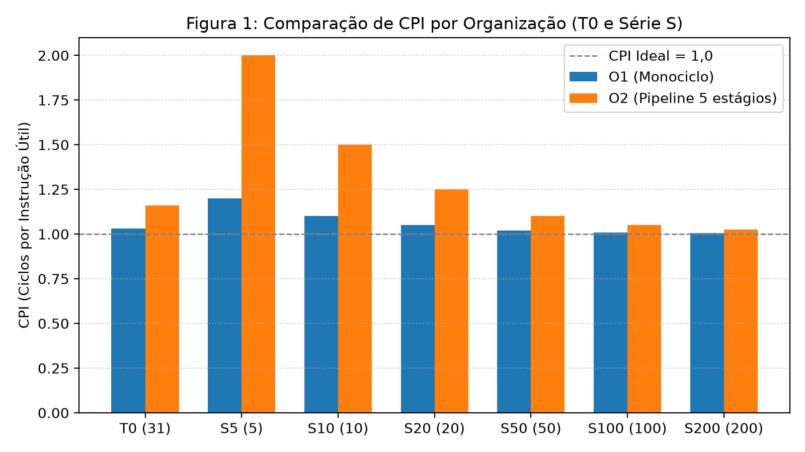
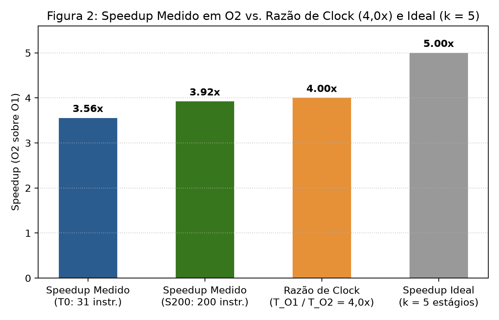
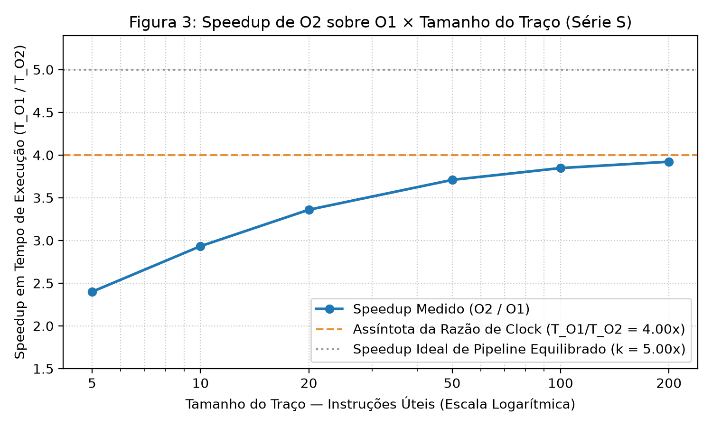

# Relatório Técnico (Formato SBC) — Implementação e Avaliação de Desempenho das Organizações MIPS32 Monociclo (O1) e Pipeline de 5 Estágios (O2)

**Autor:** Alonso Fernandes Cavalcante  
**Instituição:** Departamento de Ciência da Computação — Universidade Federal de Roraima (DCC/UFRR)  
**Disciplina:** Arquitetura e Organização de Computadores  

---

## Resumo
Este trabalho apresenta o projeto em nível de transferência entre registradores (RTL) em VHDL-2008, a verificação funcional e a avaliação experimental de desempenho de duas organizações microarquiteturais para um subconjunto de 10 instruções da arquitetura MIPS32: uma organização de linha de base Monociclo (**O1**) e uma organização em Pipeline escalar de 5 estágios (**O2**) sem encaminhamento (*forwarding*), equipada com Unidade de Detecção de Conflitos (dados RAW, estruturais e de controle) e semântica de aborto e congelamento arquitetural. A corretude funcional é validada contra o simulador de referência MARS 4.5 por meio de um testbench único unificado (`tb_cpu.vhd`). Utilizando a regra única de caminho crítico e a tabela de atrasos de componentes de Patterson e Hennessy (Seção 4.5, Figura 4.27), obtêm-se períodos de relógio de $0{,}80\text{ ns}$ para **O1** e $0{,}20\text{ ns}$ para **O2** (razão assintótica de clock de $4{,}00\times$). Os experimentos sobre o traço principal `T0` (31 instruções úteis) e a Série `S` (`S5` a `S200`) demonstram um *speedup* em tempo de execução que evolui de $2{,}40\times$ (`S5`) a $3{,}92\times$ (`S200`), evidenciando o impacto do desequilíbrio entre estágios e da sobrecarga fixa de 4 ciclos de enchimento e esvaziamento do pipeline.

---

## 1. Introdução
O paralelismo em nível de instrução explorado pela técnica de *pipelining* constitui um dos pilares do projeto de processadores modernos [1]. Enquanto uma organização monociclo executa integralmente cada instrução em um único ciclo de relógio — cujo período é penalizado pela soma em série de todas as unidades funcionais ao longo do caminho crítico —, uma organização em pipeline subdivide o caminho de dados em estágios sequenciais isolados por registradores de estágio. Essa subdivisão permite sobrepor temporalmente a execução de múltiplas instruções e reduzir o período de relógio ao atraso do estágio mais lento.

Este relatório documenta as decisões de projeto, a metodologia de avaliação e a análise crítica dos resultados obtidos na implementação das organizações **O1 (Monociclo)** e **O2 (Pipeline de 5 estágios: IF, ID, EX, MEM, WB)** em VHDL-2008, atendendo integralmente aos requisitos R1 a R7 da especificação.

---

## 2. Arquitetura das Organizações O1 e O2 (Issue #21)

### 2.1. Subconjunto da ISA e Componentes Compartilhados (Requisitos R1 e R2)
Ambas as organizações implementam exatamente o mesmo subconjunto de 10 instruções do MIPS32:
- **Aritméticas e Lógicas de Formato R (`opcode = 000000`)**: `add` (`funct = 0x20`), `sub` (`0x22`), `and` (`0x24`), `or` (`0x25`) e `slt` (`0x2A`).
- **Imediato Aritmético de Formato I**: `addi` (`opcode = 001000`).
- **Transferência de Dados**: `lw` (`opcode = 100011`) e `sw` (`opcode = 101011`).
- **Desvio Condicional**: `beq` (`opcode = 000100`), com alvo relativo a `PC + 4`.
- **Término de Programa**: `break` (`opcode = 000000`, `funct = 0x0D`), que sinaliza o fim da execução sem alterar o estado arquitetural e estaciona o `PC` no próprio endereço da instrução `break`.

Para garantir comparabilidade justa, **O1** e **O2** compartilham integralmente os módulos de caminho de dados em `comum/`: ULA de 32 bits (`ula.vhd`), decodificador secundário da ULA (`alu_control.vhd`), extensor de sinal (`sign_ext.vhd`), banco de 32 registradores (`banco_reg.vhd`), memória de instruções (`instruction_memory.vhd`) e memória de dados (`data_memory.vhd`). Ambas as memórias têm capacidade de **1024 palavras de 32 bits (4 KB)**, indexadas por `addr(11 downto 2)` com dobramento modular (*wrap-around*) para endereços acima de 4 KB.

### 2.2. Escolha da Linha de Base O1: Monociclo vs. Multiciclo
Optou-se pela organização **Monociclo** como linha de base (**O1**) em vez de uma organização Multiciclo. Uma arquitetura Multiciclo exigiria uma Máquina de Estados Finitos (FSM) de controle e apresentaria um $\text{CPI} > 1$ variável conforme a classe da instrução (3 ciclos para `beq`, 4 para tipo-R/`sw`/`addi` e 5 para `lw`). O Monociclo mantém $\text{CPI}_{\text{útil}} = 1{,}0$ constante (ou $\text{CPI}_{\text{total}} = (N+1)/N$ incluindo o ciclo do `break`), isolando de forma transparente o efeito da redução do período de clock ($T_{\text{clk}}$) proporcionado pelo pipeline **O2** em relação ao custo de enchimento e esvaziamento. Ressalta-se que a corretude funcional é aferida contra o simulador **MARS 4.5** (oráculo externo), cabendo a **O1** exclusivamente o papel de linha de base de ciclos, tempo de execução e cálculo de *speedup*.

### 2.3. Organização O2: Pipeline de 5 Estágios e Escrita em Meio Ciclo
O pipeline **O2** (`o2/cpu_top.vhd`) divide o caminho de dados nos estágios clássicos **IF** (Busca), **ID** (Decodificação e Leitura do Banco), **EX** (Execução e Resolução de Desvio), **MEM** (Acesso à Memória de Dados) e **WB** (Escrita no Banco de Registradores), separados por quatro registradores de estágio que somam **426 bits**:
- **`IF/ID` (65 bits)**: `id_valid` (1b), `id_pc` (32b) e `id_instr` (32b).
- **`ID/EX` (149 bits)**: `ex_valid` (1b), `ex_pc` (32b), operandos `ex_rd1` (32b) e `ex_rd2` (32b), imediato `ex_imm32` (32b), destino `ex_wa` (5b), `ex_funct` (6b), 8 bits de controle da ISA e `ex_is_break` (1b).
- **`EX/MEM` (107 bits)**: `mem_valid` (1b), `mem_pc` (32b), `mem_alu_result` (32b), `mem_rd2` (32b), `mem_wa` (5b), 4 bits de controle de memória/WB e `mem_is_break` (1b).
- **`MEM/WB` (105 bits)**: `wb_valid` (1b), `wb_pc` (32b), `wb_alu_result` (32b), `wb_mem_data` (32b), `wb_wa` (5b), 2 bits de controle de WB e `wb_is_break` (1b).

Conforme a convenção clássica de Patterson e Hennessy [1], o banco de registradores (`banco_reg.vhd`) realiza a escrita do estágio `WB` na **borda de descida do relógio (`falling_edge(clk)`, 1ª metade do ciclo)** e a leitura combinacional do estágio `ID` na **2ª metade do ciclo**. Dessa forma, uma instrução produtora em `WB` (distância de 3 instruções em relação à consumidora em `ID`) entrega o dado atualizado na metade do ciclo, tornando distâncias $\ge 3$ livres de conflitos de dados.

### 2.4. Unidade de Detecção de Hazards e Congelamento (Requisito R5)
Como **O2** não emprega *forwarding*, *stall* ou *flush*, sua Unidade de Detecção de Hazards monitora a cada ciclo três classes de conflito:
1. **Conflito de Dados — RAW (`hazard_type = "01"`)**: Detectado quando a instrução válida em `ID` lê `rs` ou `rt` e o registrador coincide com o destino `wa /= $zero` de uma instrução válida com `reg_write = '1'` nos estágios **`EX` (distância 1)** ou **`MEM` (distância 2)**. Reporta `hazard_pc = id_pc`.
2. **Conflito Estrutural (`hazard_type = "10"`)**: Habilitado quando o genérico `MEM_UNIFICADA = true`. Dispara quando uma instrução válida em `MEM` acessa a memória (`lw` ou `sw`) no mesmo ciclo em que `IF` busca uma instrução válida (`if_valid = '1'`). Reporta `hazard_pc = pc_reg`.
3. **Conflito de Controle (`hazard_type = "11"`)**: O desvio `beq` é avaliado no estágio **`EX`** (`ex_take_branch = ex_valid and ex_branch and ex_alu_zero`). Quando o desvio é **tomado** (`ex_take_branch = '1'`) e já existem instruções buscadas sequencialmente em `ID` ou `IF`, dispara o conflito com `hazard_pc = ex_pc`. Desvios **não tomados** (`ex_alu_zero = '0'`) não geram conflito, pois as instruções já buscadas em `PC + 4` e `PC + 8` pertencem ao fluxo sequencial correto.

Ao detectar qualquer conflito, `hazard_abort` vai a `'1'` e `freeze_pipe` bloqueia imediatamente as escritas no Banco de Registradores, na Memória de Dados, no `PC` e nos registradores de estágio.

---

## 3. Metodologia Experimental e Ameaças à Validade (Issue #22)

### 3.1. Regra Única do Período de Clock ($T_{\text{clk}}$) e Tabela de Atrasos
Para atender ao Requisito R6 sem introdução de números arbitrários, adota-se a seguinte regra única para ambas as organizações:

> **Regra de Temporização**: *"O período de clock mínimo ($T_{\text{clk}}$) de qualquer organização é determinado pelo atraso do caminho combinacional mais longo entre dois elementos de estado consecutivos somado ao overhead de registrador ($T_{\text{caminho\_max}} + t_{\text{reg}}$), respeitando a restrição de meio ciclo do banco de registradores ($T_{\text{clk}} / 2 \ge \max(t_{\text{RegWrite}}, t_{\text{RegRead}})$)."*

Utilizam-se exclusivamente os atrasos da **Figura 4.27 (Seção 4.5, p. 273) de Patterson e Hennessy (2017)** [1], sob a hipótese explícita do livro-texto de $t_{\text{reg}} = 0\text{ ps}$:
- Busca de Instrução (`IF` / $t_{\text{IMEM}}$) = $200\text{ ps}$
- Leitura do Banco de Registradores (`ID` / $t_{\text{RegRead}}$) = $100\text{ ps}$
- Operação da ULA (`EX` / $t_{\text{ULA}}$) = $200\text{ ps}$
- Acesso à Memória de Dados (`MEM` / $t_{\text{DMEM}}$) = $200\text{ ps}$
- Escrita no Banco de Registradores (`WB` / $t_{\text{RegWrite}}$) = $100\text{ ps}$

Aplicando a regra única:
- **Em O1 (Monociclo — caminho crítico da instrução `lw`)**:
  $$T_{\text{clk, O1}} = 200 + 100 + 200 + 200 + 100 = \mathbf{800\text{ ps} \ (0{,}80\text{ ns})} \implies f_{\text{max, O1}} = 1{,}25\text{ GHz}$$
- **Em O2 (Pipeline de 5 estágios — estágio mais lento entre IF, EX e MEM)**:
  $$T_{\text{clk, O2}} = \max(200, 100, 200, 200, 100) = \mathbf{200\text{ ps} \ (0{,}20\text{ ns})} \implies f_{\text{max, O2}} = 5{,}00\text{ GHz}$$
- **Verificação da Restrição de Meio Ciclo em O2**: Com $T_{\text{clk, O2}} = 200\text{ ps}$, metade do período equivale a $T_{\text{clk, O2}} / 2 = 100\text{ ps}$. Tanto a escrita em `WB` na 1ª metade do ciclo ($t_{\text{RegWrite}} = 100\text{ ps} \le 100\text{ ps}$) quanto a leitura em `ID` na 2ª metade ($t_{\text{RegRead}} = 100\text{ ps} \le 100\text{ ps}$) cabem exatamente dentro de meio período.

### 3.2. Carga de Trabalho e Verificação Cruzada no MARS
A carga de trabalho compreende:
1. **Traço Principal `T0` (`tracos/t0.hex`)**: 31 instruções úteis (+ `break`), exercitando todas as 10 instruções da ISA (incluindo `lw`, `sw` e `beq` não tomado), com distâncias entre produtora e consumidora $\ge 3$.
2. **Série `S` (`S5`, `S10`, `S20`, `S50`, `S100`, `S200`)**: Variações escalonadas de `T0` com $N \in \{5, 10, 20, 50, 100, 200\}$ instruções úteis (+ `break`), contendo todas as classes da ISA (`addi`, `sw`, `lw`, `beq` não tomado e tipo-R `add`, `sub`, `or`, `slt`, `and`) e mantendo distância mínima $\ge 3$. O código hexadecimal e o estado final de todos os 32 registradores foram validados no simulador **MARS 4.5**.
3. **Traços de Conflito (`TD`, `TE`, `TC`)**: Programas específicos para provocar e validar o aborto exato em conflito de dados RAW (`TD`), estrutural (`TE` com `MEM_UNIFICADA = true`) e de controle (`TC`).

### 3.3. Ameaças à Validade
1. **Ameaça à Validade Interna — Escrita em Meio Ciclo no RTL de O1**: Para compartilhar fisicamente a mesma entidade `comum/banco_reg.vhd` com `O2` e sincronizar com a amostragem na borda de descida do testbench (`tb_cpu.vhd`), o RTL de `O1` também dispara a escrita no banco na borda de descida. Na simulação RTL sem atraso de portas, os sinais propagam em *delta cycles*; contudo, num circuito físico real, exigir que todo o caminho da instrução `lw` ($800\text{ ps}$) estabilizasse até a metade do ciclo ($T_{\text{clk, O1}} / 2$) obrigaria o período real do Monociclo a dobrar ($1{,}60\text{ ns}$). Adotou-se na análise o valor clássico de livro-texto ($0{,}80\text{ ns}$, assumindo captura no fim do ciclo em `O1`) para não inflar artificialmente o *speedup* de `O2`.
2. **Ameaça à Validade Interna — Ausência de Overhead Físico de Registradores de Pipeline**: O modelo da Figura 4.27 assume $t_{\text{reg}} = 0\text{ ps}$ e despreza atrasos de multiplexadores e *clock skew*. Na síntese em FPGA/ASIC, o tempo de *setup* e propagação ($t_{\text{pc-q}} + t_{\text{setup}} \approx 20\text{ a }30\text{ ps}$) reduziria ligeiramente a razão de clock abaixo de $4{,}00\times$.
3. **Ameaça à Validade Externa — Ausência de *Stalls*, *Forwarding* e Desvios Tomados na Série S**: Como **O2** aborta na presença de conflitos, os traços avaliados (`T0` e Série `S`) são estaticamente escalonados com distância $\ge 3$ e desvios não tomados. Em códigos compilados reais sem escalonamento estático, ciclos de bolha (*stalls*) para `lw-use` e *flushes* em desvios tomados aumentariam o CPI de `O2` acima de $(N+5)/N$.

---

## 4. Resultados Experimentais e Análise Crítica (Issue #23)

### 4.1. Verificação dos Traços de Conflito em O2 (`TD`, `TE`, `TC`)

| Traço | `MEM_UNIFICADA` | Conflito Esperado | `hazard_type` Obtido | `hazard_pc` Obtido | `hazard_cycle` Obtido | Resultado |
| :--- | :---: | :--- | :---: | :---: | :---: | :---: |
| `td.hex` | `false` | Dados — RAW (`01`) | `01` (`1`) | `0x00000004` (ID) | `3` | **0 erros** |
| `te.hex` | `true` | Estrutural (`10`) | `10` (`2`) | `0x0000000C` (IF) | `4` | **0 erros** |
| `te.hex` | `false` | Nenhum (`00`) | `00` (`0`) | — | 9 ciclos (`done=1`) | **0 erros** |
| `tc.hex` | `false` | Controle (`11`) | `11` (`3`) | `0x00000000` (EX) | `3` | **0 erros** |

### 4.2. Métricas de Desempenho em `T0` e na Série `S` (`metricas_completas.csv`)

| Traço | $N_{\text{úteis}}$ | Ciclos O1 | Ciclos O2 | CPI O1 | CPI O2 | Tempo O1 (ns) | Tempo O2 (ns) | Ocupação O2 (Por Estágio e Via) | **Speedup Medido ($T_{\text{O1}}/T_{\text{O2}}$)** | Razão de Clock ($T_{\text{clk,O1}}/T_{\text{clk,O2}}$) | Speedup Ideal ($k=5$) |
| :--- | :---: | :---: | :---: | :---: | :---: | :---: | :---: | :---: | :---: | :---: | :---: |
| **`S5`** | 5 | 6 | 10 | 1,2000 | 2,0000 | 4,800 | 2,000 | 60,00% | **2,4000×** | 4,00× | 5,00× |
| **`S10`** | 10 | 11 | 15 | 1,1000 | 1,5000 | 8,800 | 3,000 | 73,33% | **2,9333×** | 4,00× | 5,00× |
| **`S20`** | 20 | 21 | 25 | 1,0500 | 1,2500 | 16,800 | 5,000 | 84,00% | **3,3600×** | 4,00× | 5,00× |
| **`T0`** | 31 | 32 | 36 | 1,0323 | 1,1613 | 25,600 | 7,200 | 88,89% | **3,5556×** | 4,00× | 5,00× |
| **`S50`** | 50 | 51 | 55 | 1,0200 | 1,1000 | 40,800 | 11,000 | 92,73% | **3,7091×** | 4,00× | 5,00× |
| **`S100`** | 100 | 101 | 105 | 1,0100 | 1,0500 | 80,800 | 21,000 | 96,19% | **3,8476×** | 4,00× | 5,00× |
| **`S200`** | 200 | 201 | 205 | 1,0050 | 1,0250 | 160,800 | 41,000 | 98,05% | **3,9220×** | 4,00× | 5,00× |

### 4.3. Análise Crítica: Speedup Medido vs. Razão de Clock ($4{,}00\times$) vs. Speedup Ideal ($k = 5{,}00\times$)

Os resultados experimentais permitem responder de forma quantitativa a duas questões centrais de arquitetura de computadores:

1. **Por que a assíntota real do pipeline O2 é $4{,}00\times$ e não o limite ideal clássico $k = 5{,}00\times$?**  
   O *speedup* teórico clássico igual ao número de estágios ($k = 5$) pressupõe que o caminho crítico monociclo ($800\text{ ps}$) seja particionado em **5 estágios perfeitamente equilibrados** de $800 / 5 = 160\text{ ps}$ cada. Na organização **O2**, porém, os estágios **não são equilibrados**: enquanto `IF`, `EX` e `MEM` exigem $200\text{ ps}$ cada, os estágios `ID` e `WB` exigem apenas $100\text{ ps}$ cada. Como o relógio síncrono do pipeline é limitado pelo estágio mais lento ($\max(200, 100, 200, 200, 100) = 200\text{ ps}$), há uma ociosidade temporal intrínseca de $100\text{ ps}$ por ciclo nos estágios `ID` e `WB`. Essa assimetria reduz o teto máximo de ganho de frequência de $5{,}00\times$ para a **Razão de Clock Assintótica de $800 / 200 = 4{,}00\times$**.

2. **Por que o *speedup* medido é inferior a $4{,}00\times$ nos programas testados, mas aproxima-se desse valor à medida que $N$ cresce?**  
   Para qualquer traço livre de conflitos com $N$ instruções úteis (+ 1 instrução `break`), **O1** executa exatamente em $C_{\text{O1}} = N + 1$ ciclos, ao passo que **O2** requer $C_{\text{O2}} = N + 5$ ciclos (gastando **4 ciclos adicionais** para esvaziar os 5 estágios até que o `break` alcance `WB`). Portanto, a ocupação média de cada estágio em **O2** é dada por:
   $$\text{Ocupação}_{\text{O2}}(N) = \frac{N + 1}{N + 5}, \qquad \text{Speedup}_{\text{medido}}(N) = 4{,}00 \times \frac{N + 1}{N + 5}$$
   - Quando $N$ é pequeno (`S5`, $N = 5$), os 4 ciclos de enchimento/esvaziamento representam $40\%$ de todos os ciclos da execução ($10$ ciclos), derrubando a ocupação para $60{,}00\%$, elevando o CPI para $2{,}0000$ e limitando o *speedup* a **$2{,}4000\times$**.
   - Em `T0` ($N = 31$), a sobrecarga de 4 ciclos dilui-se em 36 ciclos totais (ocupação de $88{,}89\%$, CPI de $1{,}1613$), elevando o *speedup* para **$3{,}5556\times$**.
   - Em `S200` ($N = 200$), a taxa de ocupação de todos os 5 estágios atinge **$98{,}05\%$**, o CPI cai para **$1{,}0250$** e o *speedup* alcança **$3{,}9220\times$** ($98{,}05\%$ da assíntota de clock de $4{,}00\times$), comprovando experimentalmente a convergência assintótica prevista pela teoria de pipelines escalares.

---

## 5. Conclusão
As organizações **O1 (Monociclo)** e **O2 (Pipeline de 5 estágios)** foram integralmente implementadas em VHDL-2008 e verificadas sem erros em 18 cenários de simulação automatizados pelo script `./run_all.sh`. A Unidade de Detecção de Hazards identificou com precisão de ciclo e endereço os conflitos RAW (`TD`), estrutural (`TE`) e de controle (`TC`), e a avaliação experimental na Série `S` demonstrou com exatidão matemática o impacto do desequilíbrio entre estágios e da latência de enchimento/esvaziamento sobre o *speedup* real.

---

## Referências
[1] PATTERSON, D. A.; HENNESSY, J. L. **Computer Organization and Design: The Hardware/Software Interface** (Organização e Projeto de Computadores). 5. ed. Morgan Kaufmann / Elsevier, 2017. Seção 4.5, Figura 4.27, p. 273.
